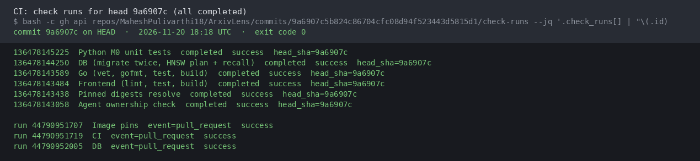
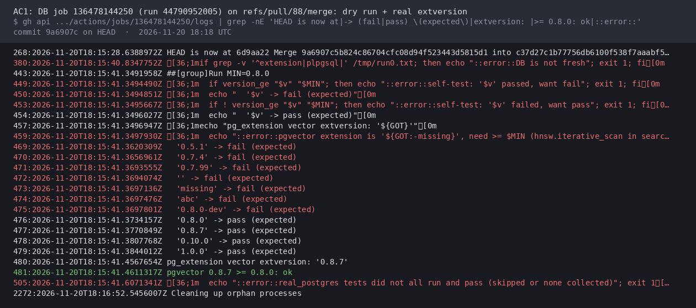
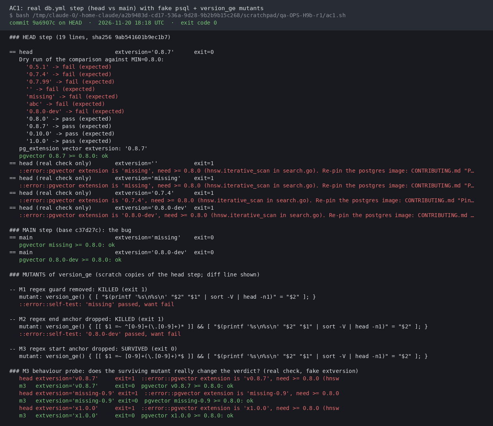
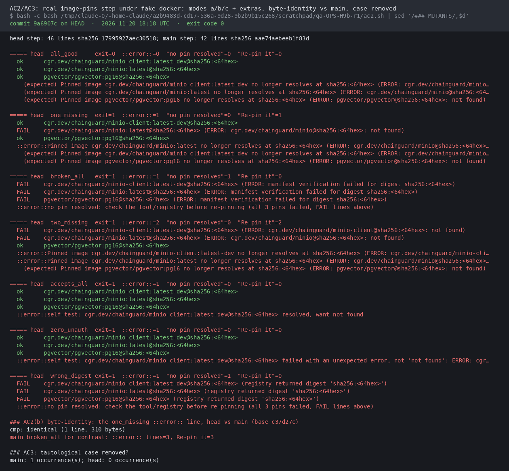
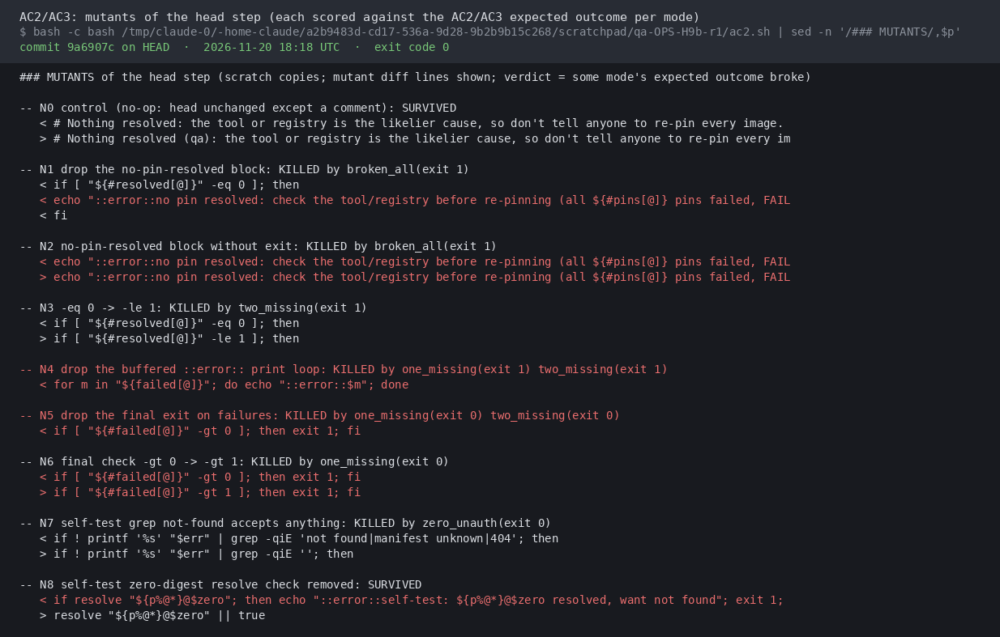
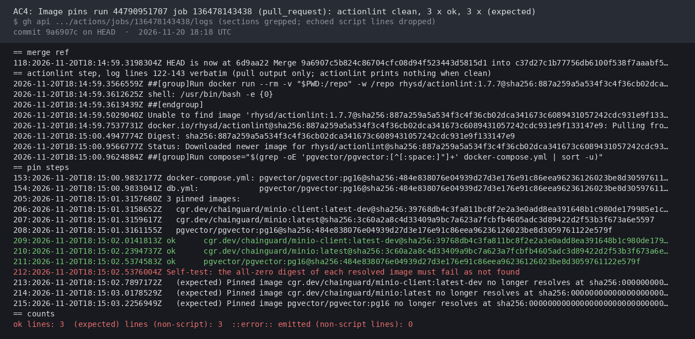
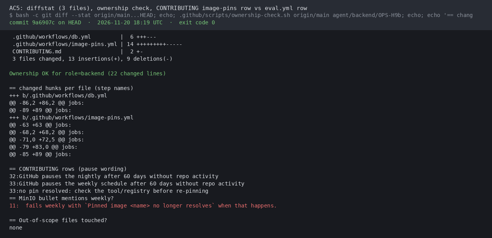

_Provenance: saved verbatim by the orchestrator from the qa-reviewer's PR #88 comment (https://github.com/MaheshPulivarthi18/ArxivLens/pull/88#issuecomment-7047273582); the QA harness could not write this file._

[qa-reviewer] QA round 1 for OPS-H9b: **PASS**

# QA report — OPS-H9b · PR #88 · round 1

**Verdict:** PASS
**Reviewed commit:** `9a6907c5b824c86704cfc08d94f523443d5815d1` (CI ran on merge `6d9aa22`, i.e. head into current main `c37d27c`) · **Date:** 2026-11-20
**Ticket:** [agents/tasks/OPS-H9b.md](https://github.com/MaheshPulivarthi18/arxivlens-agents/blob/main/agents/tasks/OPS-H9b.md) · **PRD:** Technical PRD §10 (CI harness, no PRD row); OPS-H9 QA nits 5, 7, 8 + PM note
**Evidence:** https://github.com/MaheshPulivarthi18/arxivlens-agents/tree/b55a09d/agents/reviews/OPS-H9b/evidence (the report file was not committed: the QA harness refused the write, so this comment is the report and the orchestrator saves it)

## Test results
| Check | Source | Result |
|---|---|---|
| Go (vet, gofmt, test, build) | CI job 136478143589 | pass ([00]) |
| Python M0 unit tests | CI job 136478145225 | pass ([00]) |
| Frontend (lint, test, build) | CI job 136478143484 | pass ([00]) |
| Agent ownership check | CI job 136478143058 + local | pass: `Ownership OK for role=backend (22 changed lines)` ([06]) |
| DB (migrate twice, HNSW plan + recall) | CI job 136478144250, run 44790952005 | pass ([01]) |
| Pinned digests resolve (image-pins.yml, `pull_request`) | CI job 136478143438, run 44790951707 | pass ([05]) |
| Step harness (AC1 mutants, AC2 a/b/c, AC3) | local: real step bodies extracted with PyYAML, run under `bash -e` with fake `docker`/`psql` | as specified ([02], [03], [04]); sources in [07] |
| actionlint / shellcheck | local: not run (not in the sandbox) | CI actionlint step printed nothing, so clean ([05]) |
| `make test-unit` / `make lint` | not run locally: no Go/Python/frontend source changed | CI green |
| `make eval` | not run: no retrieval/answering change | n/a |

## Acceptance criteria
| AC | Met? | Evidence |
|---|---|---|
| AC1 `version_ge` numeric only | ✅ | CI DB job 136478144250, log lines 469-481: `'missing'`, `'abc'`, `'0.8.0-dev'` plus `0.5.1`/`0.7.4`/`0.7.99`/`''` give `fail (expected)`; `0.8.0`/`0.8.7`/`0.10.0`/`1.0.0` give `pass (expected)`; then `pg_extension vector extversion: '0.8.7'` and `pgvector 0.8.7 >= 0.8.0: ok` ([01]). Harness on the real step ([02]): main's step prints `pgvector missing >= 0.8.0: ok` and `pgvector 0.8.0-dev >= 0.8.0: ok` with exit 0 (the bug). Head fails both, with the error message unchanged. Mutant M1 (regex guard removed) gives `::error::self-test: 'missing' passed, want fail`. M2 (`$` anchor dropped) is killed by `0.8.0-dev`. M3 (`^` anchor dropped) survives: see finding 1 |
| AC2 "no pin resolved" hint | ✅ | [03]: (a) `all_good`: exit 0, 0 `::error::`. (b) `one_missing`: exit 1, 1 `::error::`, `cmp: identical (1 line, 310 bytes)` against the line from main's step, 0 `no pin resolved`. (c) `broken_all`: exit 1, exactly one `::error::no pin resolved: check the tool/registry before re-pinning (all 3 pins failed, FAIL lines above)`, 0 `Re-pin it` (main prints 3 × Re-pin). Extra mode `two_missing`: 2 × Re-pin, no hint. Mutants ([04]): every one is killed by at least one mode: dropping the block, dropping its `exit`, `-eq 0`→`-le 1`, dropping the buffered `::error::` loop, and dropping or weakening the final `exit 1` |
| AC3 self-test | ✅ | `case "$msg" in` occurs once on main and 0 times on head ([03]). `accepts_all` (the zero digest resolves) gives `::error::self-test: …@sha256:0…0 resolved, want not found`, exit 1. `zero_unauth` gives `…unexpected error, not 'not found': … 401 Unauthorized`, exit 1 ([03]). Mutant N7 on the not-found grep is killed by `zero_unauth` ([04]) |
| AC4 real CI | ✅ | `image-pins.yml` has `on.pull_request.paths` covering `db.yml` and `image-pins.yml`, so this PR's run counts as the AC's evidence: run 44790951707 / job 136478143438 on `refs/pull/88/merge`. The actionlint step (both workflows) prints only the image pull, so it is clean. `ok      ` appears for all 3 pins, `(expected)` 3 times, and 0 `::error::` lines are emitted ([05]) |
| AC5 docs + scope | ✅ | The `image-pins.yml` row says "GitHub pauses the weekly schedule after 60 days without repo activity", in the same style as the `eval.yml` row ("GitHub pauses the nightly after 60 days without repo activity"), and names the `no pin resolved: check the tool/registry before re-pinning` message ([06]). Diffstat: 3 files, +13/−9. Hunks fall only in the `pgvector >= 0.8.0` step (db.yml) and the `Every pinned digest resolves` step (image-pins.yml). No out-of-scope file; ownership OK. The PR body matches this ticket (title, spec link, files) |

## PRD fit
Technical PRD §10 harness: the pgvector gate now fails closed on non-numeric output. If the tool or registry is down, the job now prints one honest "check the tool first" error, not three false re-pin instructions. When some pins resolve, the per-image re-pin line is byte-identical to before. No secrets, permissions, contracts or thresholds changed.

## Findings
1. **[nit]** No dry-run row covers the regex's `^` anchor. Mutant M3 (`=~ [0-9]+(\.[0-9]+)*$`) passes the whole dry run, and on that mutant `v0.8.7`, `missing-0.9` and `x1.0.0` print `>= 0.8.0: ok` (head fails all three) ([02]). Adding e.g. `v0.8.7` to the must-fail list would pin it. AC1 doesn't require it, and real `extversion` values don't look like that.
2. **[nit]** The MinIO bullet in CONTRIBUTING "Pinned images" still says `image-pins.yml` "fails weekly with `Pinned image <name> no longer resolves`", with no pause note and no mention of the `no pin resolved` case ([06]). The ticket allowed this edit but didn't require it ("if it repeats 'weekly'"), and the bullet does repeat "weekly".
3. **[nit]** When one pin is missing, that image now appears twice: an inline `FAIL    <pin> (<err>)` line, then the `::error::` line after the loop, which now comes after the `ok` lines. The build note discloses this. The `::error::` text is byte-identical, so the annotation itself is unchanged.

Observation on pre-existing code (not a finding): mutant N8, which removes the self-test's "zero digest resolved" check, survives. The not-found grep right after that check also fails on a resolving zero digest (empty `$err`), so this is defence in depth, not a gap.

No blocking findings.

## Missing tests
- A dry-run row with a non-numeric prefix (`v0.8.7`), see finding 1.

## Hand-off
PASS → pm-lead final review. Nits 1–3 are optional follow-ups.

## Evidence
- [00] CI check runs: 
- [01] AC1 DB job log: 
- [02] AC1 harness + mutants: 
- [03] AC2/AC3 fake-docker modes: 
- [04] AC2/AC3 mutants: 
- [05] AC4 image-pins job log: 
- [06] AC5 scope + docs: 
- [07] Harness sources: [07-harness-sources.txt](https://github.com/MaheshPulivarthi18/arxivlens-agents/blob/b55a09d/agents/reviews/OPS-H9b/evidence/07-harness-sources.txt)

---
_Generated by [Claude Code](https://claude.ai/code)_
