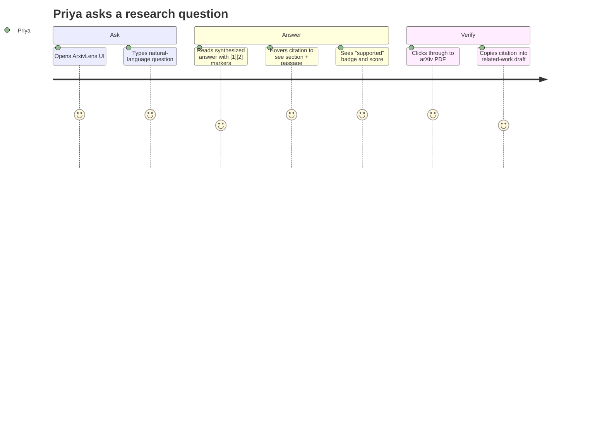
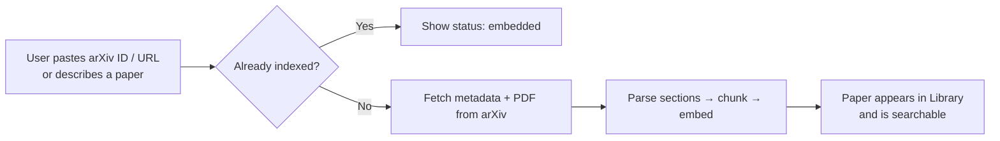
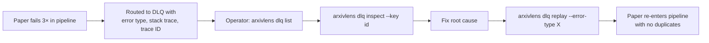
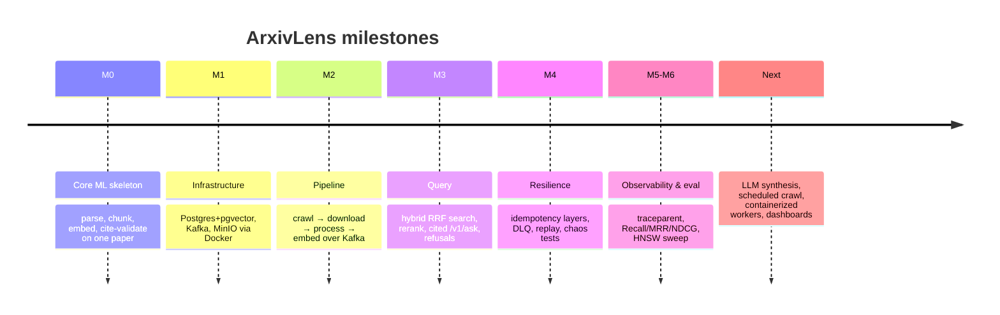

# ArxivLens: Product Requirements Document

| | |
|---|---|
| **Product** | ArxivLens |
| **Doc type** | Product PRD |
| **Owner** | Mahesh Pulivarthi |
| **Status** | v1 (MVP built), iterating |
| **Last updated** | 2026-11-01 |
| **Companion** | [Technical PRD](PRD-Technical.md) |

---

## 1. Summary

ArxivLens turns the arXiv firehose into a searchable, question-answerable research library. Users type a natural-language question and get an answer grounded in specific sections of real papers. Each claim carries a citation that links to the source PDF and has been checked to confirm the cited passage actually supports it. If nothing in the library is relevant, ArxivLens says so rather than inventing an answer.

## 2. Problem

- **Volume.** arXiv's `cs.AI` and `cs.LG` categories receive thousands of new papers a month, and no researcher can track them by reading.
- **Keyword search falls short.** arXiv search matches words in titles and abstracts. It misses papers that discuss the same idea in different terms, and it never looks inside the paper body.
- **General chatbots can't be trusted for literature work.** LLM answers about research often cite papers that don't exist or misattribute findings. Researchers need claims they can verify in one click.
- **Getting the evidence takes effort.** Even with the right paper, finding the specific section that answers a question means skimming a 20-page PDF.

## 3. Target users and personas

| Persona | Description | Core need |
|---|---|---|
| **Priya, ML researcher** | PhD student or industry researcher writing related-work sections | "What approaches exist for X, and where exactly does each paper say so?" |
| **Arjun, applied ML engineer** | Evaluating techniques to adopt in production | Fast, trustworthy answers with links to the method/experiments sections |
| **Lena, research lead** | Tracks a sub-field for a team | Keep a curated, always-fresh corpus for a set of categories |
| **Sam, platform engineer** | Operates the system | Visibility into pipeline health, failed papers, and one-command recovery |

## 4. Goals and non-goals

### Goals
1. **Grounded answers.** Every answer comes with section-level citations that are automatically checked for support.
2. **Semantic and keyword recall.** Find relevant passages whether or not they share vocabulary with the query.
3. **Fresh corpus.** Continuously ingest new papers for configured categories, and ingest any single paper on demand.
4. **Honest refusals.** When the corpus can't answer a question, say so and don't guess.
5. **Operable.** Failures are visible, explained, and replayable without data loss or duplication.

### Non-goals (v1)
- Full-corpus coverage of all of arXiv (scoped to chosen categories plus on-demand papers)
- User accounts, sharing, or multi-tenant libraries
- Non-arXiv sources (Semantic Scholar, ACL Anthology, OpenReview)
- Figure, table, and equation understanding (text only)
- Hosted SaaS deployment (local or self-hosted first)

## 5. User journeys

### 5.1 Ask a research question

### 5.2 Add a paper that isn't in the library

### 5.3 Operator recovers failed papers

## 6. Features and requirements

Priority: **P0** = MVP must-have · **P1** = next · **P2** = later

Status: ✅ done (verified against the code 2026-11-01, PM-1) · ◐ partial · ⏳ not started. Every ⏳/◐ row carries an acceptance statement or a linked task spec in `agents/tasks/`.

### 6.1 Discovery and ingestion
| ID | Requirement | Priority | Status | Acceptance / task |
|---|---|---|---|---|
| ING-1 | Crawl arXiv by query/category, newest first, respecting arXiv's ~1 req / 3 s policy | P0 | ✅ | — |
| ING-2 | Download and store each paper's PDF once (versioned, content-hashed) | P0 | ✅ | — |
| ING-3 | Split papers into sections using typography; chunk into ~512-token passages with overlap, prefixed by paper + section title | P0 | ✅ | — |
| ING-4 | On-demand ingest by arXiv ID or URL from the UI | P0 | ✅ | — |
| ING-5 | "Discover" ingest: describe a paper in words → best arXiv match is ingested | P1 | ✅ | — |
| ING-6 | Scheduled continuous crawling (cron) per category | P1 | ⏳ | [ING-6](../agents/tasks/ING-6.md): a crawl loop per configured category stops at a stored `since` watermark; a second run with no new papers emits zero `papers.discovered` events; a kill + restart creates no duplicate or skipped papers. Default categories: ADR-0005 (Proposed). |
| ING-7 | Handle new arXiv versions (v2, v3) as distinct records | P0 | ✅ | — |

### 6.2 Search and Q&A
| ID | Requirement | Priority | Status | Acceptance / task |
|---|---|---|---|---|
| QA-1 | Hybrid search combining semantic vectors and keyword (BM25) via rank fusion | P0 | ✅ | — |
| QA-2 | Cross-encoder reranking of top candidates | P0 | ✅ | — |
| QA-3 | Answers carry numbered citations `[n]` mapping to paper, section, passage, PDF link | P0 | ✅ | — |
| QA-4 | Each citation is verified (semantic similarity ≥ threshold) and labeled supported/unsupported | P0 | ◐ partial | Verified on the happy path (cosine similarity ≥ `SupportThreshold = 0.50` in `internal/query/rag.go`). Fails open: when the embedder call fails or the cited chunk has no embedding, the citation is labelled supported with score 0.75 without being verified. Remaining: [AI-2](../agents/tasks/AI-2.md) makes it fail closed (unverified → unsupported, score 0). |
| QA-5 | Refuse cleanly when no passage passes the relevance bar | P0 | ✅ | — |
| QA-6 | De-prioritize appendix, supplementary, and table passages unless strongly relevant | P1 | ✅ | — |
| QA-7 | Filter by arXiv category | P1 | ✅ (API) | — |
| QA-8 | LLM-generated synthesis over retrieved passages (replacing the template answer) | P0-next | ⏳ | [QA-8](../agents/tasks/QA-8.md): with no LLM configured, behaviour is identical to today; fabricated markers are dropped and LLM errors fall back to the template; `make eval` with the LLM on meets the §8 supported / refusal / `/v1/ask` p95 targets and does not regress the EVAL-1 baseline. Blocked on ADR-0001 and ADR-0002 (Proposed). |
| QA-9 | Streaming answers | P2 | ⏳ | Backlog (after QA-8, not yet specced). *Proposed acceptance (pm-lead, needs human approval)*: the answer text renders progressively in the UI; citations and support labels are only shown after validation finishes; the non-streaming `/v1/ask` keeps working unchanged. |

### 6.3 Library and UI
| ID | Requirement | Priority | Status | Acceptance / task |
|---|---|---|---|---|
| UI-1 | Hero search box → synthesis view with references stack | P0 | ✅ | — |
| UI-2 | Papers library listing indexed papers and status | P0 | ✅ | — |
| UI-3 | Ingest modal with progress feedback | P0 | ✅ | — |
| UI-4 | Infrastructure modal showing corpus/pipeline stats | P1 | ✅ | — |
| UI-5 | Saved questions / export citations (BibTeX) | P2 | ◐ partial | Per-citation "Copy BibTeX" exists (`frontend/src/components/ReferencesStack.jsx`). Remaining: [FE-2](../agents/tasks/FE-2.md) exports every citation of an answer as one `.bib` file. Saved questions: not specced; *Proposed acceptance (pm-lead, needs human approval)*: a user can save a question, it survives reload (local storage, no accounts per §4 non-goals), and re-running it re-queries the API. |

### 6.4 Operations
| ID | Requirement | Priority | Status | Acceptance / task |
|---|---|---|---|---|
| OPS-1 | Automatic retry (3× backoff) and dead-letter routing with full diagnostics | P0 | ✅ | — |
| OPS-2 | CLI to list, inspect, and replay DLQ events (with dry-run and error-type filter) | P0 | ✅ | — |
| OPS-3 | Reprocessing never creates duplicate rows or embeddings | P0 | ✅ | — |
| OPS-4 | Per-paper status lookup (`discovered → downloaded → chunked → embedded`) | P0 | ✅ | — |
| OPS-5 | End-to-end trace ID across all stages | P1 | ✅ (propagation) | — |
| OPS-6 | Metrics dashboard (throughput, lag, DLQ depth) | P2 | ⏳ | Backlog (not yet specced; needs the Prometheus metrics item from Technical PRD §11 first). *Proposed acceptance (pm-lead, needs human approval)*: a view showing per-stage throughput, consumer lag per group, and DLQ depth per topic, refreshed at least every 30 s. |

## 7. Experience principles

1. **Evidence first.** Citations are the product, and the answer text summarizes them.
2. **Say "I don't know."** A refusal beats a confident hallucination.
3. **One click to the source.** Every claim reaches its PDF in one click.
4. **Fast enough to stay in flow.** Search results in about a second.

## 8. Success metrics

Datasets and the gate come from EVAL-1 — **pending EVAL-1 ([PR #2](https://github.com/MaheshPulivarthi18/ArxivLens/pull/2), not merged yet)**.
Until it merges, `make eval` falls back to `scripts/evaluate_retrieval.py` with its hardcoded queries.
Thresholds are mirrored in `evals/thresholds.json`; change them only through an Accepted ADR.

| Category | Metric | Target (v1) | Dataset | Measured by |
|---|---|---|---|---|
| **Quality** | Retrieval Recall@5 on eval set | ≥ 0.80 | `evals/retrieval.jsonl` (papers in `evals/corpus.txt`) | `make eval` → `scripts/evaluate_retrieval.py`, gated on the "Hybrid RRF + Rerank" mode (`retrieval_recall_at_5_min`). Definition of Recall@5: [ADR-0006](adr/0006-recall-at-5-definition.md) (Proposed) |
| | MRR / NDCG@5 (hybrid + rerank vs. BM25 baseline) | Hybrid+rerank beats both single-mode baselines | `evals/retrieval.jsonl` | `make eval` (`hybrid_rerank_beats_baselines`). Caveat: the eval's rerank mode uses the BGE bi-encoder, not the `/internal/rerank` cross-encoder — fixed by [EVAL-2](../agents/tasks/EVAL-2.md) |
| | % citations marked *supported* | ≥ 90% | `evals/answer.jsonl` | `make eval` → `scripts/evaluate_answers.py` (`supported_citation_rate_min`). Caveat: inflated while `rag.go` marks citations supported when the embedder call fails — fixed by [AI-2](../agents/tasks/AI-2.md) |
| | Correct refusal rate on out-of-corpus questions | ≥ 95% | `evals/refusal.jsonl` | `make eval` → `scripts/evaluate_answers.py` (`correct_refusal_rate_min`) |
| **Latency** | `/v1/search` p95 | < 1.5 s | `evals/retrieval.jsonl` queries | Not gated yet — [EVAL-2](../agents/tasks/EVAL-2.md). Reference hardware: Technical PRD §9 (Proposed) |
| | `/v1/ask` p95 | < 3 s | `evals/answer.jsonl` + `evals/refusal.jsonl` | `make eval` → `scripts/evaluate_answers.py` (`ask_p95_latency_ms_max`) |
| | On-demand ingest (single paper) | < 60 s | — | Not automated. Manual: `time curl -X POST localhost:8080/v1/papers/ingest -H 'Content-Type: application/json' -d '{"arxiv_id":"<id>"}'` on the Technical PRD §9 reference machine (Proposed) |
| **Reliability** | Papers stuck outside `embedded` or DLQ | 0 | Pipeline run over `evals/corpus.txt` | `make test-full` (M2 pipeline) + `arxivlens status` / `arxivlens dlq list`; not a single automated check yet |
| | Duplicate chunks after replay/redelivery | 0 | Fixture paper in M4 | `make test-full` → `tests/test_m4_chaos.py::test_idempotency_duplicate_event_row_invariance` |
| **Engagement** | Citation click-through rate | ≥ 30% of answers | — | Not measured: no UI telemetry exists, and adding it needs a product decision (local-first, no accounts) |

Other tools: `scripts/benchmark_hnsw.py` (vector-index latency sweep) and the M3 suite (`tests/test_m3_query.py`, functional checks of search, ask, and refusal).

## 9. Release plan

## 10. Risks and mitigations

| Risk | Impact | Mitigation |
|---|---|---|
| arXiv rate limits / blocking | Ingestion stalls | Built-in 3 s rate limit, descriptive User-Agent, resumable via Kafka offsets |
| Poor PDF parsing (two-column, scanned) | Bad chunks → bad answers | Typography heuristics, section prefixing, DLQ for parse failures, replay after fixes |
| Template answers feel shallow | Low perceived value | LLM synthesis is the top roadmap item; citation validation already in place to guard it |
| Hallucinated citations once an LLM is added | Trust loss | Marker range check, per-sentence support scoring, unsupported badge |
| Embedding model change | Re-index cost | Embeddings keyed by `(chunk_id, model)`, so models can co-exist during migration |

## 11. Open questions

Each question is tracked by an ADR. All are **Proposed**; only the owner sets Accepted or Rejected.

1. Which LLM provider or local model should drive synthesis, and how much latency and cost is acceptable? → [ADR-0001](adr/0001-llm-provider-and-budget.md)
2. Should unsupported citations be hidden, flagged, or trigger regeneration? → [ADR-0003](adr/0003-unsupported-citation-policy.md)
3. Which categories form the default continuously crawled corpus? → [ADR-0005](adr/0005-default-crawl-categories.md)
4. Is multi-user or hosted deployment in scope for v2? → [ADR-0007](adr/0007-multi-user-hosted-v2-scope.md)
5. How is Recall@5 defined for the §8 target (paper-level or chunk-level)? → [ADR-0006](adr/0006-recall-at-5-definition.md)
