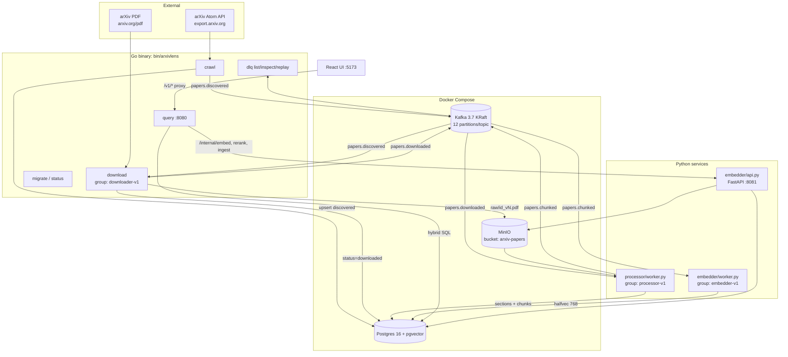
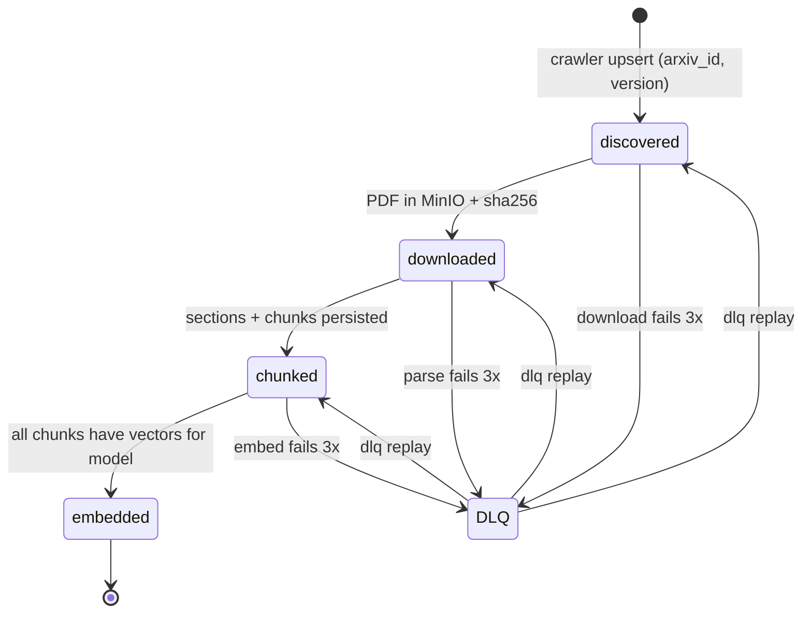
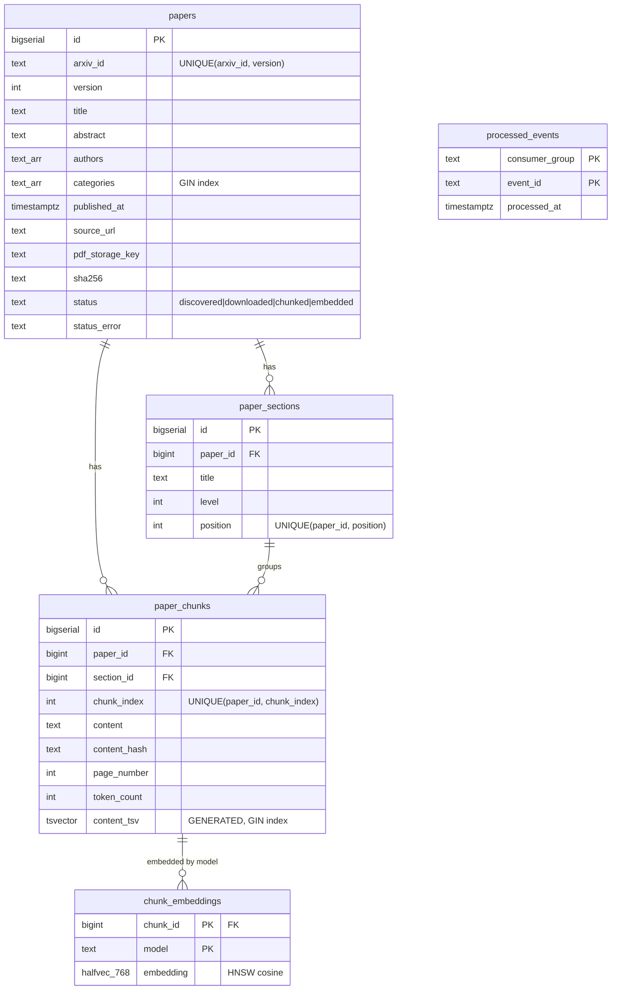
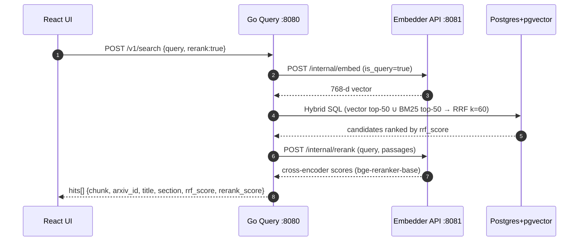
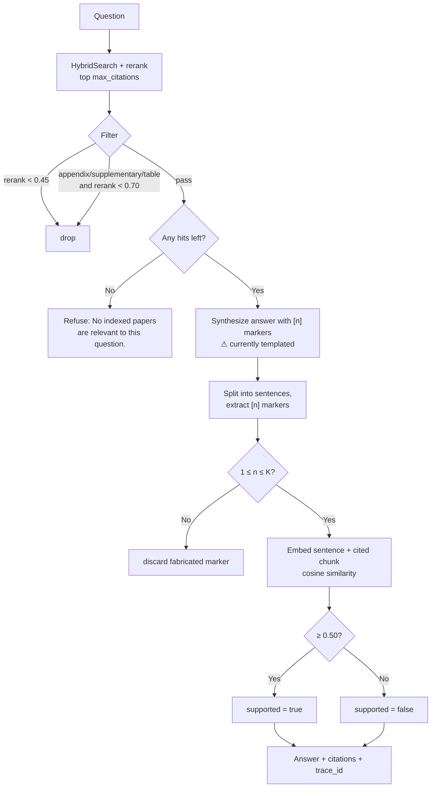
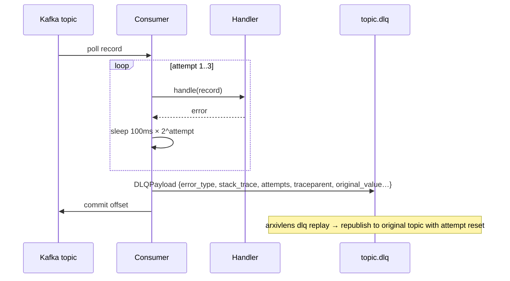

# ArxivLens: Technical Requirements Document

| | |
|---|---|
| **Doc type** | Technical PRD / design doc |
| **Owner** | Mahesh Pulivarthi |
| **Status** | v1 implemented |
| **Last updated** | 2026-11-01 |
| **Companion** | [Product PRD](PRD-Product.md) |

---

## 1. Overview

ArxivLens is a polyglot, event-driven system:

- **Go** handles I/O-bound work: crawling, downloading, the HTTP query API, the DLQ tooling, and the CLI.
- **Python** handles ML-bound work: PDF parsing, tokenization, embeddings, and reranking.
- **Kafka** decouples the stages. **MinIO** stores the PDFs, and Kafka events carry only a reference to them (the claim-check pattern).
- **PostgreSQL + pgvector** is the single store for metadata, chunks, full-text indexes, and vectors, so hybrid search is one SQL query.

## 2. System architecture



### 2.1 Component responsibilities

| Component | Lang | Consumes | Produces | Writes |
|---|---|---|---|---|
| Crawler (`internal/crawler`) | Go | arXiv Atom API | `papers.discovered` | `papers` (status `discovered`) |
| Downloader (`internal/downloader`) | Go | `papers.discovered` | `papers.downloaded` | MinIO `raw/{id}_v{n}.pdf`; `papers` (`downloaded`, `sha256`) |
| Processor (`services/processor`) | Py | `papers.downloaded` | `papers.chunked` | `paper_sections`, `paper_chunks`, `processed_events`; `papers` (`chunked`) |
| Embedder worker (`services/embedder/worker.py`) | Py | `papers.chunked` | — | `chunk_embeddings`; `papers` (`embedded`) |
| Embedder API (`services/embedder/api.py`) | Py | HTTP | — | Embeds queries, reranks, runs synchronous ingest |
| Query service (`internal/query`) | Go | HTTP | — | Read-mostly; triggers on-demand ingest |
| DLQ manager (`internal/dlq`) | Go | `*.dlq` | original topics | — |

## 3. Paper lifecycle



## 4. Event contracts

### 4.1 Topics

| Topic | Key | Partitions | Producer → Consumer |
|---|---|---|---|
| `papers.discovered` | `arxiv_id` | 12 | crawler → downloader |
| `papers.downloaded` | `arxiv_id` | 12 | downloader → processor |
| `papers.chunked` | `arxiv_id` | 12 | processor → embedder |
| `papers.{stage}.dlq` | original key | 12 | any consumer → `arxivlens dlq` |

Keying by `arxiv_id` keeps all events for one paper ordered within a single partition.

### 4.2 Envelope (`shared/events/events.go` / `.py`)

```json
{
  "event_id": "01J8Z...ULID",
  "event_type": "papers.downloaded",
  "occurred_at": "2026-08-23T14:32:10.123Z",
  "paper_id": "2307.08691",
  "version": 1,
  "attempt": 0,
  "traceparent": "00-<trace-id>-<span-id>-01",
  "payload": { ... }
}
```

| Event | Payload fields |
|---|---|
| `papers.discovered` | `arxiv_id, version, title, abstract, authors[], categories[], published_at, source_url` |
| `papers.downloaded` | `arxiv_id, version, pdf_storage_key, sha256, bytes, storage_bucket` |
| `papers.chunked` | `paper_db_id, arxiv_id, version, chunk_count` |
| DLQ | `original_topic, partition, offset, original_key, original_value, error_type, error_message, stack_trace, attempts, consumer_group, failed_at, traceparent` |

`event_id` is a ULID, so IDs sort by time and work as dedup keys. `traceparent` is copied from each incoming event to the event it produces, so one trace covers the whole pipeline.

## 5. Data model



Design choices:
- **`halfvec(768)`** halves vector storage compared with `vector(768)`, with negligible loss in recall.
- **HNSW cosine index (gap):** no migration creates it yet. `chunk_embeddings_hnsw_idx` (`m=16, ef_construction=64`) is created only by `scripts/benchmark_hnsw.py`, so a fresh `make migrate` has exact (sequential) vector scans. Tracked by [OPS-H5](../agents/tasks/OPS-H5.md).
- **`(chunk_id, model)` primary key** lets several embedding models co-exist, so a re-index can run without downtime.
- **Generated `tsvector`** keeps BM25-style full-text search in sync with no application code.
- **`processed_events`** is the per-consumer-group idempotency ledger.

## 6. Processing pipeline details

### 6.1 Section extraction (PyMuPDF)
1. Collect every text span's font size and compute the **median**, which serves as the base body size.
2. A line is a **heading** if it is shorter than 100 characters and any of these hold:
   - its font size is ≥ 1.15× the median
   - it matches a numbered pattern (`^\d+(\.\d+)?\s+[A-Z]` or Roman numerals)
   - it is bold and shorter than 60 characters
3. Level 1 if the font is ≥ 1.3× the median, otherwise level 2. Numbering is stripped from the title.
4. Text before the first heading goes into an implicit `Abstract` section.

### 6.2 Chunking (`TokenChunker`)
- Tokenizer: the BGE tokenizer (the same vocabulary as the embedder)
- Target **512 tokens**, **75-token overlap** (capped at half the effective target)
- Each chunk is **prefixed with the paper title and section title**, so it stays meaningful on its own
- A `content_hash` per chunk lets the embedder skip unchanged chunks

### 6.3 Embedding (`BGEEmbedder`)
- `BAAI/bge-base-en-v1.5`, 768-d, L2-normalized, max 512 tokens
- Queries get the BGE instruction prefix *"Represent this sentence for searching relevant passages: "*. Passages don't.
- Device auto-select: MPS → CUDA → CPU. Batch size 32.

## 7. Query path

### 7.1 Hybrid search with Reciprocal Rank Fusion



```sql
WITH vec AS (
  SELECT pc.id AS chunk_id,
         ROW_NUMBER() OVER (ORDER BY ce.embedding <=> $1::halfvec) AS rank
  FROM chunk_embeddings ce JOIN paper_chunks pc ON ...
  ORDER BY ce.embedding <=> $1::halfvec LIMIT 50
), kw AS (
  SELECT pc.id AS chunk_id,
         ROW_NUMBER() OVER (ORDER BY ts_rank_cd(pc.content_tsv, q) DESC) AS rank
  FROM paper_chunks pc, plainto_tsquery('english', $2) q
  WHERE pc.content_tsv @@ q
  ORDER BY ts_rank_cd(pc.content_tsv, q) DESC LIMIT 50
)
SELECT ..., COALESCE(1.0/(60+v.rank),0) + COALESCE(1.0/(60+k.rank),0) AS rrf_score
FROM ... ORDER BY rrf_score DESC LIMIT $5;
```

### 7.2 `/v1/ask`: grounded answer with citation validation



Constants are set in `internal/query/rag.go`: relevance cutoff `0.45`, auxiliary-section cutoff `0.70`, `SupportThreshold = 0.50`.
Known gap (Product PRD QA-4 ◐ partial): the diagram shows the happy path. If the embedder call fails or the cited chunk has no embedding, `rag.go` currently sets `score = 0.75`, `supported = true` without verification. [AI-2](../agents/tasks/AI-2.md) changes this to fail closed (`supported = false`, `score = 0`).

### 7.3 On-demand ingest (`/v1/papers/ingest`, `/v1/papers/discover`)
This path runs synchronously and skips Kafka, for an interactive experience:
1. Normalize input (ID, `abs/` URL, or `pdf/` URL) to a clean arXiv ID. For `discover`, take the top hit from an arXiv relevance search.
2. Fetch metadata from the Atom API, download the PDF, and upload it to MinIO.
3. Call `POST /internal/ingest` on the embedder API, which runs the processor and embedder logic in-process.
4. Return section, chunk, and embedding counts.

## 8. Reliability design

### 8.1 Four idempotency layers

| Layer | Where | Mechanism |
|---|---|---|
| **L1: natural keys** | Crawler, downloader | `UNIQUE(arxiv_id, version)` upsert; MinIO `ObjectExists` check before download |
| **L2: transactional ledger** | Processor | `INSERT INTO processed_events(consumer_group, event_id)` in the *same transaction* as the chunk writes. On a duplicate it rolls back, skips the writes, and still re-emits downstream. |
| **L3: content hashing** | Embedder | `LEFT JOIN chunk_embeddings ON model`, so only chunks missing vectors for this model get embedded |
| **L4: commit-after-process** | All consumers | The Kafka offset is committed only after the handler succeeds or the message is routed to the DLQ (at-least-once delivery) |

### 8.2 Retry and DLQ



Chaos tests (`tests/test_m4_chaos.py`) check two invariants: (a) redelivering an event leaves row counts unchanged, and (b) a corrupt PDF lands in the DLQ with a full diagnostic payload.

## 9. Non-functional requirements

| Area | Requirement |
|---|---|
| **Throughput** | Horizontal scale up to 12 consumers per group (one per partition) |
| **Latency** | `/v1/search` p95 < 1.5 s; `/v1/ask` p95 < 3 s, measured on the **primary reference machine** below (*Proposed*, see "Reference hardware"), with the full stack (infra + workers + query service + embedder API) on that one machine, a warm cache (models loaded, one warm-up query), and the `evals/` corpus indexed |
| **External politeness** | ≤ 1 arXiv API request / 3 s; identifying User-Agent |
| **Durability** | PDFs in MinIO volume; Postgres and Kafka on named Docker volumes |
| **Observability** | W3C `traceparent` on every event and DLQ record; `trace_id` returned from `/v1/ask` |
| **Portability** | Go services build to a single static binary; Python services have Dockerfiles |
| **Security (v1)** | Local-only defaults. Production must override credentials through env vars, enable TLS for MinIO/Postgres, and put the query API behind auth. |

### Reference hardware (for latency targets) — *Proposed (pm-lead, needs human approval)*

This whole subsection, including the gating rule below, is a pm-lead proposal from PM-1. It is not yet policy. Until
Mahesh approves it (or decides otherwise), the existing gates (e.g. EVAL-1's `ask_p95_latency_ms_max`) apply unchanged
on whatever machine runs `make eval`.

| Profile | Spec | Proposed use |
|---|---|---|
| **Primary (MPS)** | Apple silicon M-series (M1 Pro or newer), 16 GB unified memory, macOS 14+, PyTorch MPS backend for the embedder and reranker, Docker Desktop with ≥ 8 GB RAM for Postgres/Kafka/MinIO | Latency targets above are **gated** on this profile |
| **CPU-only** | x86-64, 8 vCPU, 16 GB RAM, no GPU (e.g. a CI runner or cloud VM), PyTorch CPU | Measured and reported, but **informational only**; expect slower rerank and embed |

*Proposed rule:* report each latency number with the profile it was measured on. A result from any other machine must
say so and cannot pass or fail a latency gate. *(The owner should also confirm his actual dev machine matches the primary profile.)*

### Postgres tuning (compose)
`shared_buffers=512MB`, `work_mem=32MB`, `effective_cache_size=1536MB`, `maintenance_work_mem=256MB`. These are sized for HNSW builds and hybrid queries on a 16 GB dev machine.

## 10. Testing and evaluation

| Suite | Scope | Infra needed |
|---|---|---|
| `test_m0.py` | Chunker prefixing, 768-d normalized embeddings, citation validator | None |
| `test_m1_infra.py` | pgvector + schema, 12-partition topics, MinIO bucket | Docker |
| `test_m2_pipeline.py` | Sections/chunks persisted, embedding cosine ops | Docker + workers |
| `test_m3_query.py` | Health, hybrid + rerank, grounded ask, refusal, status | + query + embedder API |
| `test_m4_chaos.py` | Duplicate-event invariance, corrupt PDF → DLQ | Full stack |
| `test_m5_m6_telemetry_eval.py` | traceparent round-trip, ranking metrics, HNSW index | Full stack |

- **`make eval`** (`scripts/eval_gate.py`, pending EVAL-1 / PR #2) runs the retrieval and answer evals over `evals/` and fails on any `evals/thresholds.json` miss.
- **`scripts/evaluate_retrieval.py`** compares BM25, vector, hybrid RRF, and RRF + rerank on Recall@5, MRR, and NDCG@5.
- **`scripts/benchmark_hnsw.py`** sweeps `ef_search ∈ {20, 40, 80, 160}` and reports p50/p95/p99 latency, QPS, and index build time.

## 11. Roadmap

| Priority | Item | Notes | Task |
|---|---|---|---|
| P0 | **LLM answer synthesis** | Replace the template in `rag.go` with prompted generation over reranked chunks. The citation validator already guards against fabricated markers. | [QA-8](../agents/tasks/QA-8.md) (Blocked: ADR-0001, ADR-0002) |
| P0 | Containerize processor + embedder in compose | Dockerfiles exist; add services and GPU/MPS notes | [OPS-H1](../agents/tasks/OPS-H1.md) |
| P1 | Scheduled crawler | Cron/loop with a `since` watermark per category | [ING-6](../agents/tasks/ING-6.md) |
| P1 | Unify Python deps | Add `minio`, `ulid-py`, `fastapi`, `uvicorn` to a single `requirements.txt` | [OPS-H2](../agents/tasks/OPS-H2.md) |
| P1 | Batch embedding in RAG validation | Embed all sentences and chunks in one call instead of one call each | [AI-3](../agents/tasks/AI-3.md) |
| P1 | Span export | OTLP exporter to Jaeger/Tempo | Backlog |
| P2 | Metrics | Prometheus: consumer lag, DLQ depth, stage latency | Backlog |
| P2 | Auth + rate limiting on query API | Needed before any shared deployment | Backlog |
| P2 | Figure/table extraction | Multi-modal chunks | Backlog (post-v1; Product PRD §4 non-goal for v1) |

## 12. Open technical questions

Each question is tracked by an ADR. All are **Proposed**; only the owner sets Accepted or Rejected.

1. Should LLM synthesis run in Go (calling the API directly) or in the Python embedder API? → [ADR-0002](adr/0002-where-synthesis-runs.md)
2. Should the on-demand ingest path publish to Kafka instead of running synchronously, for consistent idempotency and DLQ behavior? → [ADR-0004](adr/0004-on-demand-ingest-path.md)
3. What HNSW parameters (`m`, `ef_construction`) should production use once the corpus passes ~1M chunks? → [ADR-0008](adr/0008-hnsw-parameters-at-scale.md)
4. Should the embedding model be swapped to a long-context model (e.g. 8k tokens) to reduce chunk boundary effects? → [ADR-0009](adr/0009-long-context-embedding-model.md)
5. How is Recall@5 computed (paper-level or chunk-level)? → [ADR-0006](adr/0006-recall-at-5-definition.md)
