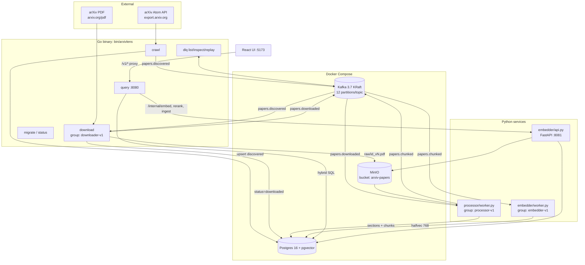
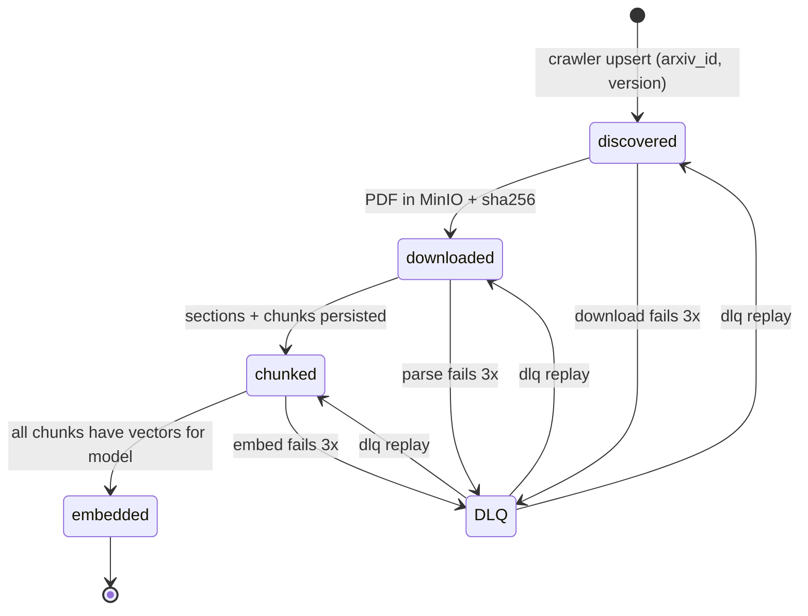
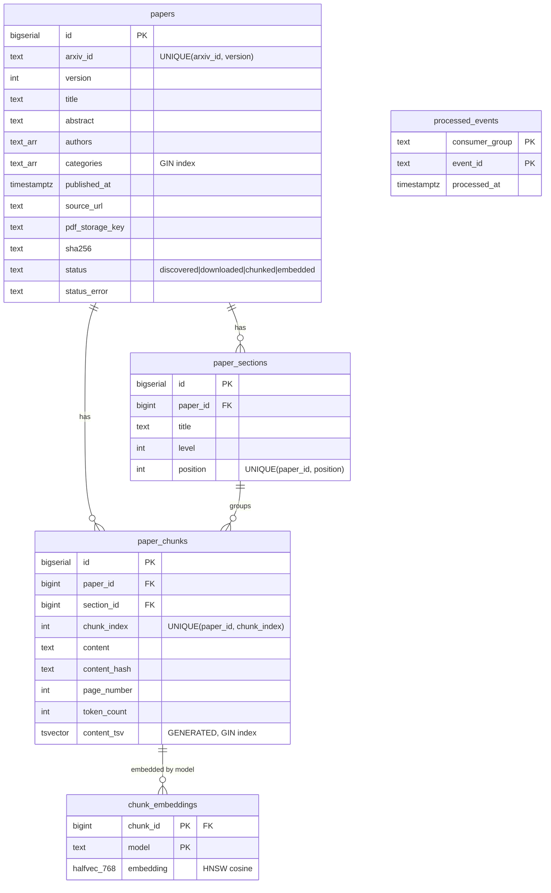
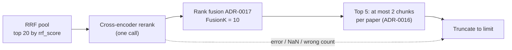
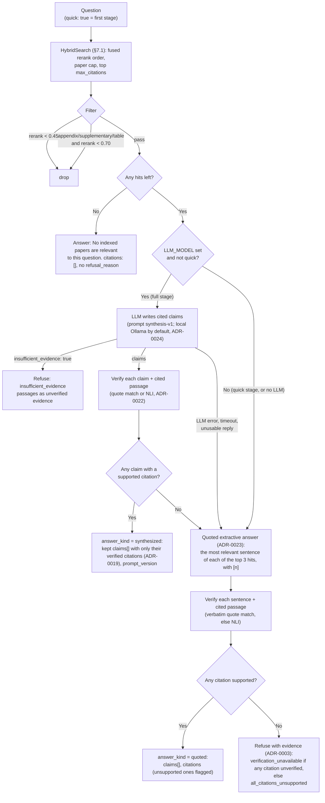
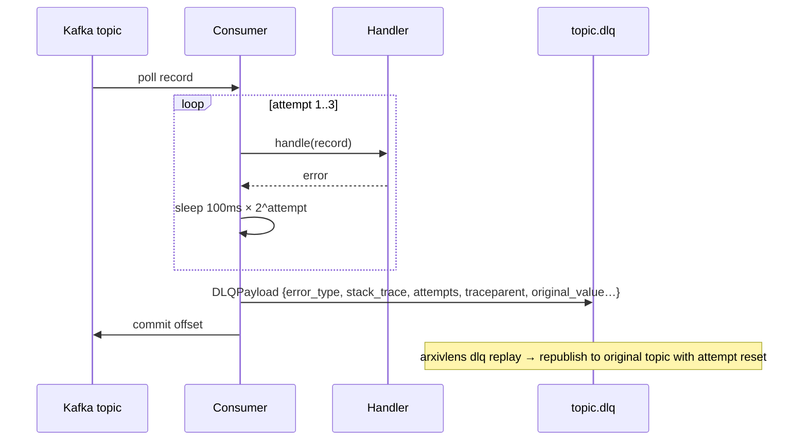

# ArxivLens: Technical Requirements Document

| | |
|---|---|
| **Doc type** | Technical PRD / design doc |
| **Owner** | Mahesh Pulivarthi |
| **Status** | v1 implemented |
| **Last updated** | 2026-11-01 |
| **Companion** | [Product PRD](PRD-Product.md) |

---

## 1. Overview

ArxivLens is a polyglot, event-driven system:

- **Go** handles I/O-bound work: crawling, downloading, the HTTP query API, the DLQ tooling, and the CLI.
- **Python** handles ML-bound work: PDF parsing, tokenization, embeddings, and reranking.
- **Kafka** decouples the stages. **MinIO** stores the PDFs, and Kafka events carry only a reference to them (the claim-check pattern).
- **PostgreSQL + pgvector** is the single store for metadata, chunks, full-text indexes, and vectors, so hybrid search is one SQL query.

## 2. System architecture



### 2.1 Component responsibilities

| Component | Lang | Consumes | Produces | Writes |
|---|---|---|---|---|
| Crawler (`internal/crawler`) | Go | arXiv Atom API | `papers.discovered` | `papers` (status `discovered`) |
| Downloader (`internal/downloader`) | Go | `papers.discovered` | `papers.downloaded` | MinIO `raw/{id}_v{n}.pdf`; `papers` (`downloaded`, `sha256`) |
| Processor (`services/processor`) | Py | `papers.downloaded` | `papers.chunked` | `paper_sections`, `paper_chunks`, `processed_events`; `papers` (`chunked`) |
| Embedder worker (`services/embedder/worker.py`) | Py | `papers.chunked` | — | `chunk_embeddings`; `papers` (`embedded`) |
| Embedder API (`services/embedder/api.py`) | Py | HTTP | — | Embeds queries, reranks, runs synchronous ingest |
| Query service (`internal/query`) | Go | HTTP | — | Read-mostly; triggers on-demand ingest |
| DLQ manager (`internal/dlq`) | Go | `*.dlq` | original topics | — |

## 3. Paper lifecycle



## 4. Event contracts

### 4.1 Topics

| Topic | Key | Partitions | Producer → Consumer |
|---|---|---|---|
| `papers.discovered` | `arxiv_id` | 12 | crawler → downloader |
| `papers.downloaded` | `arxiv_id` | 12 | downloader → processor |
| `papers.chunked` | `arxiv_id` | 12 | processor → embedder |
| `papers.{stage}.dlq` | original key | 12 | any consumer → `arxivlens dlq` |

Keying by `arxiv_id` keeps all events for one paper ordered within a single partition.

### 4.2 Envelope (`shared/events/events.go` / `.py`)

```json
{
  "event_id": "01J8Z...ULID",
  "event_type": "papers.downloaded",
  "occurred_at": "2026-08-23T14:32:10.123Z",
  "paper_id": "2307.08691",
  "version": 1,
  "attempt": 0,
  "traceparent": "00-<trace-id>-<span-id>-01",
  "payload": { ... }
}
```

| Event | Payload fields |
|---|---|
| `papers.discovered` | `arxiv_id, version, title, abstract, authors[], categories[], published_at, source_url` |
| `papers.downloaded` | `arxiv_id, version, pdf_storage_key, sha256, bytes, storage_bucket` |
| `papers.chunked` | `paper_db_id, arxiv_id, version, chunk_count` |
| DLQ | `original_topic, partition, offset, original_key, original_value, error_type, error_message, stack_trace, attempts, consumer_group, failed_at, traceparent` |

`event_id` is a ULID, so IDs sort by time and work as dedup keys. `traceparent` is copied from each incoming event to the event it produces, so one trace covers the whole pipeline.

## 5. Data model



Design choices:
- **`halfvec(768)`** halves vector storage compared with `vector(768)`, with negligible loss in recall.
- **HNSW cosine index:** migration `000002_chunk_embeddings_hnsw` creates `chunk_embeddings_hnsw_idx` (`m=16, ef_construction=64`, the same as `scripts/benchmark_hnsw.py`; [OPS-H5](../agents/tasks/OPS-H5.md)). The values at scale are still open (ADR-0008, Proposed).
- **`(chunk_id, model)` primary key** lets several embedding models co-exist, so a re-index can run without downtime.
- **Generated `tsvector`** keeps BM25-style full-text search in sync with no application code.
- **`processed_events`** is the per-consumer-group idempotency ledger.

## 6. Processing pipeline details

### 6.1 Section extraction (PyMuPDF)
1. Collect every text span's font size and compute the **median**, which serves as the base body size.
2. A line is a **heading** if it is shorter than 100 characters and any of these hold:
   - its font size is ≥ 1.15× the median
   - it matches a numbered pattern (`^\d+(\.\d+)?\s+[A-Z]` or Roman numerals)
   - it is bold and shorter than 60 characters
3. Level 1 if the font is ≥ 1.3× the median, otherwise level 2. Numbering is stripped from the title.
4. Text before the first heading goes into an implicit `Abstract` section.

### 6.2 Chunking (`TokenChunker`)
- Tokenizer: the BGE tokenizer (the same vocabulary as the embedder)
- Target **512 tokens**, **75-token overlap** (capped at half the effective target)
- Each chunk is **prefixed with the paper title and section title**, so it stays meaningful on its own
- A `content_hash` per chunk lets the embedder skip unchanged chunks

### 6.3 Embedding (`BGEEmbedder`)
- `BAAI/bge-base-en-v1.5`, 768-d, L2-normalized, max 512 tokens
- Queries get the BGE instruction prefix *"Represent this sentence for searching relevant passages: "*. Passages don't.
- Device auto-select: MPS → CUDA → CPU. Batch size 32.

## 7. Query path

### 7.1 Hybrid search with Reciprocal Rank Fusion

```mermaid
sequenceDiagram
    autonumber
    participant UI as React UI
    participant Q as Go Query :8080
    participant EA as Embedder API :8081
    participant PG as Postgres+pgvector

    UI->>Q: POST /v1/search {query, rerank:true}
    Q->>EA: POST /internal/embed (is_query=true)
    EA-->>Q: 768-d vector
    Q->>PG: Hybrid SQL (vector top-50 ∪ BM25 top-50 → RRF k=60)
    PG-->>Q: rerank pool: top max(20, limit) by rrf_score (RerankPool = 20, ADR-0010)
    Q->>EA: POST /internal/rerank (query, all pool passages, one call)
    EA-->>Q: cross-encoder scores (bge-reranker-base; fp16 on mps/cuda, ADR-0020)
    Note over Q: 1. rank fusion (ADR-0017): key = 1/(FusionK + rerank rank) + 1/(FusionK + RRF rank), FusionK = 10, ties keep RRF order
    Note over Q: 2. paper diversity (ADR-0016): the top 5 hold at most PaperCap = 2 chunks per paper, filled from the rest in fused order
    Note over Q: 3. truncate to limit. On rerank error, timeout/cancel, wrong score count, or a NaN/±Inf score: keep RRF order, log trace_id, no error to caller
    Q-->>UI: hits[] {chunk, arxiv_id, version, page, title, section, rrf_score, rerank_score}
```



With `rerank:false` the SQL returns the top `limit` by `rrf_score` and there is no rerank call. The pool size is
`RerankPool = 20` in `internal/query/search.go` (ADR-0010). If the latency budget forces a smaller pool, ADR-0010 records
the change, and the eval's `RRF_POOL_SIZE` must follow.

```sql
WITH vec AS (
  SELECT pc.id AS chunk_id,
         ROW_NUMBER() OVER (ORDER BY ce.embedding <=> $1::halfvec) AS rank
  FROM chunk_embeddings ce JOIN paper_chunks pc ON ...
  ORDER BY ce.embedding <=> $1::halfvec LIMIT 50
), kw AS (
  SELECT pc.id AS chunk_id,
         ROW_NUMBER() OVER (ORDER BY ts_rank_cd(pc.content_tsv, q) DESC) AS rank
  FROM paper_chunks pc, plainto_tsquery('english', $2) q
  WHERE pc.content_tsv @@ q
  ORDER BY ts_rank_cd(pc.content_tsv, q) DESC LIMIT 50
)
SELECT ..., COALESCE(1.0/(60+v.rank),0) + COALESCE(1.0/(60+k.rank),0) AS rrf_score
FROM ... ORDER BY rrf_score DESC LIMIT $5;  -- $5 = max(20, limit) when rerank=true, else limit
```

### 7.2 `/v1/ask`: grounded answer with citation validation



**Two stages.** The UI first sends `"quick": true` and shows the quoted answer (gated p95 < 3 s, ADR-0019), then sends
the same question without `quick`. With `LLM_MODEL` set that second request returns the written answer (`answer_kind:
synthesized`); with no LLM, or when the LLM fails or nothing it wrote verifies, it returns the quoted answer again and the
UI keeps the first one. Without `LLM_MODEL` both requests take the quoted path.

**Verify** (every pair, both paths): markers outside `1..K` are dropped. A sentence that is a verbatim quote of the cited chunk
(after whitespace / inline-reference normalisation) is supported with score 1. Any other pair goes, in one batch, to the
embedder's `POST /internal/verify`, which returns the NLI P(entailment) of the claim by the passage (max over sentence
windows; `cross-encoder/nli-deberta-v3-small` by default, `ARXIVLENS_NLI_MODEL`). Score ≥ `SupportThreshold = 0.50` →
`supported`, below → `unsupported`. If the verifier is unavailable (503), errors, returns the wrong number of scores or a
score outside [0, 1], the citation is `unverified` with score 0, never supported (fail closed, AI-2). An LLM claim whose
model-given `quote` is not in the cited chunk is `unsupported`. Each citation carries its `status` (ADR-0014); each claim's
status is `supported` if any of its citations is, else `unverified` if any is (or it has none), else `unsupported`.
In a written answer a kept claim lists only its verified citations (ADR-0019). Refusals carry no `claims`, `answer_kind` or `prompt_version`; `quick`, `answer_kind` and `insufficient_evidence` are ADR-0018 (Proposed).

Constants are set in `internal/query/rag.go`: relevance cutoff `0.45`, auxiliary-section cutoff `0.70`, `SupportThreshold = 0.50`
(NLI P(entailment); calibrate on the EVAL-7 human judgments before changing it).

### 7.3 On-demand ingest (`/v1/papers/ingest`, `/v1/papers/discover`)
This path runs synchronously and skips Kafka, for an interactive experience:
1. Normalize input (ID, `abs/` URL, or `pdf/` URL) to a clean arXiv ID. For `discover`, take the top hit from an arXiv relevance search.
2. Fetch metadata from the Atom API, download the PDF, and upload it to MinIO.
3. Call `POST /internal/ingest` on the embedder API, which runs the processor and embedder logic in-process.
4. Return section, chunk, and embedding counts.

## 8. Reliability design

### 8.1 Four idempotency layers

| Layer | Where | Mechanism |
|---|---|---|
| **L1: natural keys** | Crawler, downloader | `UNIQUE(arxiv_id, version)` upsert; MinIO `ObjectExists` check before download |
| **L2: transactional ledger** | Processor | `INSERT INTO processed_events(consumer_group, event_id)` in the *same transaction* as the chunk writes. On a duplicate it rolls back, skips the writes, and still re-emits downstream. |
| **L3: content hashing** | Embedder | `LEFT JOIN chunk_embeddings ON model`, so only chunks missing vectors for this model get embedded |
| **L4: commit-after-process** | All consumers | The Kafka offset is committed only after the handler succeeds or the message is routed to the DLQ (at-least-once delivery) |

### 8.2 Retry and DLQ



Chaos tests (`tests/test_m4_chaos.py`) check two invariants: (a) redelivering an event leaves row counts unchanged, and (b) a corrupt PDF lands in the DLQ with a full diagnostic payload.

## 9. Non-functional requirements

| Area | Requirement |
|---|---|
| **Throughput** | Horizontal scale up to 12 consumers per group (one per partition) |
| **Latency** | `/v1/search` p95 < 1.5 s; `/v1/ask` p95 < 3 s for the quick stage (`"quick": true`; the LLM-written answer is reported as `ask_full_p95_ms`, not gated, ADR-0019), measured on the **reference GPU profile** below (see "Reference hardware"), with the full stack (infra + workers + query service + embedder API) on that one machine, a warm cache (models loaded, one warm-up query), and the `evals/` corpus indexed |
| **External politeness** | ≤ 1 arXiv API request / 3 s; identifying User-Agent |
| **Durability** | PDFs in MinIO volume; Postgres and Kafka on named Docker volumes |
| **Observability** | W3C `traceparent` on every event and DLQ record; `trace_id` returned from `/v1/ask` |
| **Portability** | Go services build to a single static binary; Python services have Dockerfiles |
| **Security (v1)** | Local-only defaults. Production must override credentials through env vars, enable TLS for MinIO/Postgres, and put the query API behind auth. |

### Reference hardware (for latency targets) — *Accepted (Mahesh, 2026-11-15)*

**Decision:** ArxivLens targets scholars who self-host it as a daily tool on a machine with a GPU, like the owner's
Apple-silicon Mac. CPU-only performance is not a product target. (The owner's words: "assume they will have GPUs like me
and Mac with GPU".) This adopts PM-1's proposal and adds CUDA to the gated profile.

| Profile | Spec | Use |
|---|---|---|
| **GPU (reference)** | Apple silicon M-series (M1 Pro or newer), 16 GB unified memory, macOS 14+, PyTorch MPS; **or** an x86-64/ARM Linux machine with an NVIDIA GPU and PyTorch CUDA. Docker with ≥ 8 GB RAM for Postgres/Kafka/MinIO | Latency targets above are **gated** on this profile |
| **CPU-only** | No GPU, PyTorch CPU (e.g. a GitHub runner or cloud VM) | Measured and reported, but **informational only**; expect slower rerank and embed |

*Rule:* report each latency number with the profile it was measured on. `scripts/eval_gate.py` reads the embedder's
device from `GET /healthz`: `mps`/`cuda` is gated, `cpu` is reported as `INFO (cpu-only; not gated)`, and an unknown
device is gated (fail closed). Quality gates apply on every profile, and thresholds are unchanged.

*Reranker precision (ADR-0020, Accepted 2026-11-22, #121):* on `mps`/`cuda` the embedder runs `bge-reranker-base` in fp16
(logits cast to fp32 before the sigmoid); on `cpu` it stays fp32. `EMBEDDER_RERANK_FP16=0` forces fp32; `GET /healthz` reports
`reranker_dtype`. On the reference Mac this took the gated quick-stage p95 from 3.97 s (FAIL) to 2.95 s (PASS) with
unchanged Recall@5/MRR/NDCG@5.

*Consequences:* CI's CPU eval no longer fails on `ask_p95_ms`, but still records it. ADR-0015 (cutting CPU rerank
latency) loses its product driver: it stays open only for M3's 10 s client timeout ("Known failure F1"), not for
the p95 target.

### Postgres tuning (compose)
`shared_buffers=512MB`, `work_mem=32MB`, `effective_cache_size=1536MB`, `maintenance_work_mem=256MB`. These are sized for HNSW builds and hybrid queries on a 16 GB dev machine.

## 10. Testing and evaluation

| Suite | Scope | Infra needed |
|---|---|---|
| `test_m0.py` | Chunker prefixing, 768-d normalized embeddings, citation validator | None |
| `test_m1_infra.py` | pgvector + schema, 12-partition topics, MinIO bucket | Docker |
| `test_m2_pipeline.py` | Sections/chunks persisted, embedding cosine ops | Docker + workers |
| `test_m3_query.py` | Health, hybrid + rerank, grounded ask, refusal, status | + query + embedder API |
| `test_m4_chaos.py` | Duplicate-event invariance, corrupt PDF → DLQ | Full stack |
| `test_m5_m6_telemetry_eval.py` | traceparent round-trip, ranking metrics, HNSW index | Full stack |

- **`make eval`** (`scripts/eval_gate.py`) runs the retrieval and answer evals over `evals/` and fails on any `evals/thresholds.json` miss. Latency gates apply on the GPU profile only (§9); report-only keys are listed in `REPORT_ONLY_KEYS`. CI (`eval.yml`, nightly) has no LLM, so it measures quoted answers; the real-LLM run is EVAL-8 (Modal, ADR-0021).
- **`scripts/evaluate_retrieval.py`** compares BM25, vector, hybrid RRF, and RRF + rerank on Recall@5, MRR, and NDCG@5.
- **`scripts/benchmark_hnsw.py`** sweeps `ef_search ∈ {20, 40, 80, 160}` and reports p50/p95/p99 latency, QPS, and index build time.

## 11. Roadmap

Updated 2026-11-28. Work is planned as bundles (one PR each); see `agents/board.md`.

| Priority | Item | Notes | Task |
|---|---|---|---|
| P0 | **LLM answer synthesis** | Done: with `LLM_MODEL` set, `rag.go` prompts the LLM for cited claims and verifies each one (§7.2); without it, answers quote the passages | [QA-8](../agents/tasks/QA-8.md) (Done, #46) |
| P0 | Claims, citation status and provenance in `/v1/ask` | Done: `claims[]`, citation `status`/`paper_version`/`page`/`quote`, versioned `pdf_url` (ADR-0014) | AI-8a/AI-8b (Done, #54, #65) |
| P0 | **Answer evidence UI** | Status chips and claims list done (FE-3a/3b, FE-4a). Left: the quote highlighted in its passage, `arXiv:IDvN · § · p. N`, PDF at the page, "Cited by claim n" rows, `.bib` export | [B-UI](../agents/tasks/B-UI.md) |
| P0 | **DLQ replay that resumes and can't run twice** | `dlq list` reaches the end of the topic (done, OPS-H7a). Left: list footer polish, Postgres checkpoints + replay log, advisory lock, deterministic IDs, stack replay run (closes Product PRD OPS-2) | [B-PIPE](../agents/tasks/B-PIPE.md) |
| P0 | Containerize processor + embedder in compose | Done: `make stack-up`; CI `stack.yml` | [OPS-H1](../agents/tasks/OPS-H1.md) (Done) |
| P1 | Real-LLM answer eval in CI | Local run done (2026-11-21); CI on Modal, built by Mahesh | [EVAL-8](../agents/tasks/EVAL-8.md) (ADR-0021) |
| P1 | Scheduled crawler | Done: `arxivlens crawl-loop` with a per-category watermark and a single-instance lock | [ING-6](../agents/tasks/ING-6.md) (Done, #124) |
| P1 | Eval extras | `/v1/search` p50/p95 reported (gate waits on ADR-0012); section-extraction scorer (baseline waits on hand labels) | [B-QUAL](../agents/tasks/B-QUAL.md) |
| P1 | Unify Python deps | Done: one `requirements.txt` (+ dev, light) | [OPS-H2](../agents/tasks/OPS-H2.md) (Done, #53) |
| P1 | Batch embedding in RAG validation | Done; verification now goes through `/internal/verify` in one batch | [AI-3](../agents/tasks/AI-3.md) (Done, #13) |
| P1 | Relevance bar when rerank scores are missing | Waits on ADR-0011 | [AI-5](../agents/tasks/AI-5.md) (Blocked) |
| P1 | Span export | OTLP exporter to Jaeger/Tempo | Backlog |
| P2 | Metrics | Prometheus: consumer lag, DLQ depth, stage latency | Backlog |
| P2 | Auth + rate limiting on query API | Needed before any shared deployment | Backlog |
| P2 | Streaming answers (Product PRD QA-9) | After the answer evidence UI | Backlog |
| P2 | Figure/table extraction | Multi-modal chunks | Backlog (post-v1; Product PRD §4 non-goal for v1) |

## 12. Open technical questions

Each question is tracked by an ADR. Only the owner sets Accepted or Rejected. Still **Proposed** (2026-11-28):

1. Should the on-demand ingest path publish to Kafka instead of running synchronously? → [ADR-0004](adr/0004-on-demand-ingest-path.md)
2. Default crawl categories → [ADR-0005](adr/0005-default-crawl-categories.md)
3. What HNSW parameters should production use past ~1M chunks? → [ADR-0008](adr/0008-hnsw-parameters-at-scale.md); search plan cache vs HNSW → [ADR-0013](adr/0013-search-plan-cache-and-hnsw.md)
4. Long-context embedding model? → [ADR-0009](adr/0009-long-context-embedding-model.md)
5. What `/v1/ask` does when no rerank score is available → [ADR-0011](adr/0011-ask-relevance-bar-without-rerank.md)
6. `/v1/search` p95 gate → [ADR-0012](adr/0012-search-p95-gate.md)
7. The `/v1/ask` two-stage shape and `answer_kind` → [ADR-0018](adr/0018-two-stage-ask-and-answer-kind.md)
8. Real-LLM eval in CI (Modal) → [ADR-0021](adr/0021-real-llm-ci-eval-gate.md)

Decided: ADR-0001/0002/0003/0006/0010/0014/0016/0017/0019/0020 (Accepted), ADR-0022/0023/0024 (Accepted, recorded from Mahesh's merged PRs), ADR-0015 (Superseded by §9).
